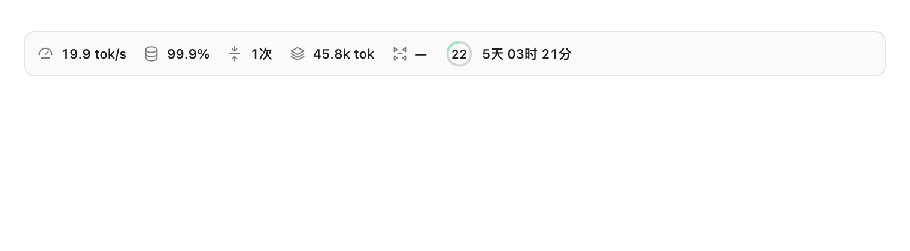

# Codex-InfoBar

当前版本：**[v0.3](https://github.com/kagami233/Codex-InfoBar/releases/tag/v0.3)**（包版本 `0.3.0`）。完整更新记录见 [CHANGELOG](CHANGELOG.md)。

在 **Codex Desktop 输入框内部**显示 token 速度、缓存比例、压缩次数、上下文余量、压缩参考余量及账户用量倒计时。支持 macOS 与 Windows 的安装与运行路径，点击原来的 Codex 图标后由后台服务自动挂载。



上图使用示例数据。

非官方项目，与 OpenAI 无关联。通过本机 Chrome DevTools Protocol (CDP) 注入独立组件，不修改官方应用包或签名。

## v0.3 新增与改进

- **临期重置卡自动使用（可选，默认关闭）**：用户已在 Codex 中允许使用重置卡，并额外开启本功能后，卡片进入最后 60 秒时重新核实账户与可用状态，再通过原生接口提交；多个窗口互斥，重试复用持久化请求编号，避免重复扣卡。开启方式见[使用说明](#临期重置卡自动使用可选)。
- **压缩余量估值改进**：综合项目配置、压缩特性、同聊天同模型/窗口的历史记录及请求增长预留，显示带 `≈` 的剩余百分比；旧版固定比例估值不再使用。
- **新对话与多窗口显示改进**：空白新对话也显示账户用量；修复临时聊天标识造成的漏挂载，更新后自动替换旧组件；窄窗口保持单行并可横向滚动。
- **Windows 安装和原图标启动改进**：更新现有用户快捷方式的启动参数，后台被动挂载；改善 Store 任务栏入口提示、服务重装/卸载、端口冲突及诊断。

本地 macOS 回归测试 89 项通过、5 项 Windows 专用测试跳过。重置卡自动使用已验证开关和挂载，真实临期兑换尚未验证；压缩余量仍是估值。详细平台验证范围及限制见下文和 [Windows 修复说明](docs/WINDOWS_FIXES.md)。

## 功能

| 指标 | 含义 |
| --- | --- |
| token 输出速度 | 当前/最后一轮真实输出 token ÷ 回合耗时，包含等待与工具执行；不是逐 token 解码速度 |
| 缓存 | 最近请求 cached_input_tokens / input_tokens |
| 压缩次数 | 手动与自动压缩均计入；只统计可读取历史中完成的压缩，显示 `1次` |
| 上下文余量 | 最近上报的上下文容量减已用 token |
| 剩余压缩余量 | `≈18%`：综合项目合并配置、特性状态、同模型/窗口近期压缩记录及下一请求增长预留的保守估值 |
| 账户用量 | 26px 圆环，圈内数字 10.4px、不带 `%`；亮色为剩余，顶部顺时针消耗 |
| 重置倒计时 | `5天 03时 21分`；若可用重置卡更早到期，改显示该卡倒计时并加卡片图标 |

新对话尚未发送消息时也显示 InfoBar：账户用量和倒计时正常显示，其余聊天统计先显示 `—`；首条消息建立真实聊天后自动切换到该聊天数据，不沿用上一聊天的统计。

窗口保留独立组件，共享采集进程。切换聊天先显示缓存、再后台更新；最多保存最近 64 个聊天的 7 天统计。账户缓存按账户及工作区隔离，重启后先验证本机账户身份，再恢复用量和绝对到期时间；倒计时继续走。默认不会自动兑换重置卡；如需在到期前使用，须主动开启临期自动使用功能，卡片单纯到期不会重置额度。

Windows 新对话发送首条消息后，侧栏可能仍保留 `client-new-thread` 临时标识。组件优先从可见输入框所属的已提交 React 树读取真实本地会话 ID，不把临时 UUID 当作日志 ID；无法验证时保留未知状态。安装更新后，采集器按源码摘要自动替换旧组件，无需重启已开启调试的客户端。

## 平台及验证范围

| 平台 | 支持路径 | 验证范围 |
| --- | --- | --- |
| macOS | 官方 Codex.app / ChatGPT.app；LaunchAgent 用户服务 | 原型已在 macOS Codex 26.1023.50603 实际挂载；发布版平台适配和诊断在 macOS 验证 |
| Windows 10/11 | Microsoft Store `OpenAI.Codex` 包；用户 Startup 启动项 | 本机源码修复已在 Store 版本 26.1027.3384.0 验证原图标启动后自动挂载；其他版本尚需验证 |

Windows 支持不是“只提供一个安装脚本”：包括 Store 包检测、主进程识别、端口所有权及回环校验、正常关闭再启动、用户后台启动和平台缓存路径。但客户端更新、组织策略、受限 PowerShell 或禁用 Windows Script Host 可能影响运行。CI 测试也不能代替真实 GUI 验证。

## 安装要求

- 安装并打开过官方 Codex Desktop，完成登录。
- Node.js **22.17 或更新版本**（推荐当前 LTS），以及 Git（使用 clone 时）。
- 原生终端运行，不要在 WSL 中安装 Windows 客户端集成。
- **没有第三方 npm 依赖，无需运行 `npm install`。**

Git 不可用时也可用 GitHub 的 Code → Download ZIP，解压后在项目目录运行相同 npm 命令。

## 最快安装：交给 Codex

复制下面一段发给 Codex，完整版本见 [自动安装提示词](docs/AUTO_INSTALL_PROMPT.md)：

```text
请安装 https://github.com/kagami233/Codex-InfoBar 。先阅读 README，识别 macOS/Windows 并检查 Node.js 22.17+，克隆到独立目录，运行 npm test 和 npm run install:service，再运行 npm run doctor。保护当前正在运行的 Codex，不立即重启；如未开启调试，告诉我保存工作后完全退出，再点击原 Codex 图标等待自动挂载。不要修改官方应用包、凭据或压缩设置，不要强制终止 Windows 客户端。确认 mounted=true 后才报告原生挂载成功；若未成功，给出具体日志、限制及下一步。最后说明安装位置和 npm run uninstall:service 卸载命令。
```

## macOS 手动安装

在 Terminal 运行：

```sh
git clone https://github.com/kagami233/Codex-InfoBar.git
cd Codex-InfoBar
node --version
npm test
npm run install:service
```

也可双击 `scripts/install-macos.command`（同样需要已安装 Node.js）。

安装时保护当前运行中的 Codex。**首次使用请等工作完成后 Command+Q 完全退出，再点击原 Codex 图标**。后台检测到新的普通启动后，等待约 15 秒，正常结束并带本机调试参数重新打开；再等待挂载，通常共约 15–30 秒。窗口可能关闭再打开一次，等状态条出现后再开始任务。

之后继续使用原来的 Codex 图标；用户级 LaunchAgent 随登录自动运行。如果不希望安装后台服务，可以先完全退出 Codex，然后在项目目录执行 `npm start`，保留终端运行。

## Windows 手动安装

使用 **PowerShell**：

```powershell
git clone https://github.com/kagami233/Codex-InfoBar.git
cd Codex-InfoBar
node --version
npm test
npm run install:service
```

或从项目目录运行 `powershell -NoProfile -ExecutionPolicy Bypass -File scripts/install-windows.ps1`，该参数只影响这次脚本进程。

安装器定位 `OpenAI.Codex` Store 包，复制独立运行文件到用户目录，并创建当前用户 Startup 的 `Codex-InfoBar.vbs`，无需管理员权限。Windows 安装、卸载和诊断通过本机 WMI 进入同一实际用户会话，避免应用容器中的 AppData 视图与后台读取位置不一致。安装器独立启动后台并等待报告就绪；后台未就绪会明确报错，不把写入启动项等同于安装成功。使用时不需要另开终端运行辅助脚本。首次安装仍保护已打开的 Codex：保存工作后完全退出，再从原图标启动，等待后台自动处理。

Windows 安装器备份并更新当前用户已有的官方 Codex `.lnk` 快捷方式（桌面、开始菜单 Programs 与任务栏固定项），保留名称和图标，直接启动官方程序并传入回环调试参数；再次点击这些图标即可一次启动客户端与状态条，无需约 15 秒后的关闭重开。后台在程序版本或端口变更时同步这些快捷方式。自定义启动参数或用户后来编辑的快捷方式不会被覆盖；卸载恢复未被用户改动的原始快捷方式。

**原有 Store 任务栏固定项不是 `.lnk`，不会使用开始菜单快捷方式的参数。** 这类固定项必须一次性取消固定，再将安装器更新后的 `ChatGPT.lnk` 通过资源管理器“显示更多选项 → 固定到任务栏”固定。之后直接点击新固定的同一官方客户端图标即可；无需脚本或终端。后台会管理系统新复制的任务栏快捷方式，在卸载时去掉本项目参数。Windows 后台始终被动挂载：缺少调试参数时明确报告 `needs-debug-launch`，不再自动关闭重开客户端。已带调试端口参数的客户端即使启动较慢也不会被后台关闭。

重装会先请求本项目后台正常停止；旧后台不响应时，仅回收经过可执行路径、完整命令行和创建时间验证的本项目 Node 后台及其采集器，不终止 Codex 或无关 Node 程序。失效锁会在验证原进程已退出或 PID 已复用后清理。

Windows 通过 Restart Manager 请求正常退出，而不是仅关闭窗口。只注册经过可执行文件路径、PID 和创建时间校验的单个客户端，使用零强制标志；客户端明确拒绝退出时保留它并记录错误，不使用强制终止。若客户端拒绝退出，可保存工作后完全退出并从原图标重开。需要手动模式时，也可以在完全退出后在项目目录执行：

```powershell
npm start
```

手动模式会在 Codex 未运行时带调试参数打开它，再加载状态条；终端需保持运行。Windows Script Host 被组织策略禁用时也用此方式。非 Store 安装暂未支持。

## 诊断与卸载

```sh
npm run doctor
npm run uninstall:service
```

`doctor` 输出 Node 版本、平台、客户端位置、后台状态及各窗口组件状态。后台必须匹配仍存活的进程和新鲜状态；旧锁、过期状态或停止采集后残留的组件不能作为成功依据。聊天窗口 `mounted:true` 才表示已挂载；`stale:false` 表示快照仍新鲜。设置页、聚焦面板等辅助窗口没有状态条是正常的。

卸载停止本项目服务、删除登录启动项，保留运行文件和缓存。完全退出再正常打开 Codex，可关闭本次调试端口。没有改写官方客户端。确认卸载后可手动删除以下数据目录。

| 内容 | macOS | Windows |
| --- | --- | --- |
| 运行文件/日志/聊天缓存 | `~/Library/Application Support/Codex-InfoBar/` | `%LOCALAPPDATA%\Codex-InfoBar\` |
| 登录服务 | `~/Library/LaunchAgents/local.codex.infobar.watcher.plist` | `%APPDATA%\Microsoft\Windows\Start Menu\Programs\Startup\Codex-InfoBar.vbs` |
| 账户缓存 | Codex 自身 localStorage，键 `codex-metrics-hud.account-cache.v1` | 同左 |

日志：`watcher.log`、`collector.log`，macOS 服务还有 `service.log` / `service-error.log`。卸载不会删除账户缓存；可由客户端本地存储清理功能清除，账户切换通知也会清除旧账户缓存。

### 从本项目早期原型迁移

若曾安装旧的 `Codex-Metrics-HUD`，先在旧项目执行 `node src/install-watcher.mjs --uninstall`，再安装本项目，避免两套后台服务同时运行。旧聊天缓存可在备份后复制：从 `CodexMetricsHUD/snapshot-cache.json` 复制到新数据目录同名文件，保留原采集时间。不复制日志、运行锁或其他项目的数据。

## 配置

以下环境变量在执行安装命令之前设置；安装时保存端口、客户端位置和 CODEX_HOME，后台沿用。变更后重新安装服务。

| 环境变量 | 默认 | 用途 |
| --- | --- | --- |
| `CODEX_INFOBAR_PORT` | `9341` | 未显式设置时，Windows 自动避让未经验证或遗留的监听，并保存所选回环端口；显式设置后固定使用该端口，冲突时报错，不关闭其他监听 |
| `CODEX_INFOBAR_APP` | 自动检测 | macOS `.app` 路径；Windows 必须是已安装 Store 包内的可执行文件 |
| `CODEX_HOME` | 用户目录的 `.codex` | 会话与模型目录位置 |
| `CODEX_INFOBAR_STATE` | 上述平台数据目录 | 自定义运行目录；安装器保存到启动项，卸载时也需提供相同值，常规安装无需设置 |

macOS 示例：`CODEX_INFOBAR_PORT=9431 npm run install:service`。
Windows 示例：`$env:CODEX_INFOBAR_PORT='9431'; npm run install:service`。

不通过本项目改变实际自动压缩设置。压缩估值按以下顺序取最早的候选触发线：模型阈值、`config/read` 项目合并配置中的总量阈值与回合结束比例、已启用的后台压缩阈值；再用同一聊天、同一模型和窗口最近 8 条压缩前用量的较低分位校准，并预留近期请求增长（最多参考线的 10%）。手动压缩记录排除；未标明类型的记录只有发生在较高上下文占用时才参与，并在快照诊断中标记为未分类样本，不宣称它们是自动压缩。模型或窗口变化不混用样本。

配置/特性查询每个项目缓存 60 秒。无法确认后台压缩是否启用时使用更保守的早期阈值先验，诊断标为 `unresolved-feature-prior`。`body_after_prefix` 的增长阈值不与全部上下文直接相减，缺少准确前缀时回退到完整窗口与已观察记录。该项仍显示 `≈`，不能承诺误差范围或精确触发点；额外工具输出、模型切换及会话临时覆盖仍可能改变实际时点。旧版只按默认 90% 算出的缓存不再展示，新估值和历史校准样本可以持久化。

## 数据与权限

仅连接本机回环 CDP，验证监听进程身份和地址。**CDP 是高权限、无独立认证的本机调试接口**，同机软件可以访问；不要开放到公网。Windows 后台只被动挂载，不自动关闭客户端；macOS 后台可对以后新启动的实例正常关闭再打开，安装当时已运行的实例受到保护。同一实例失败后不反复重试，失败重试至少间隔 10 分钟；成功连接后清除失败冷却。

本地读取对应聊天 JSONL，分块筛选统计事件，不缓存正文、图片、工具参数。只支持本地聊天，不支持云端/远程主机聊天。超大单行可能跳过，压缩计数只代表可读取记录；指标未知显示 `—`。悬停按用户定制只显示指标名称和当前值，具体异常请看日志或运行 `snapshot`。

账户查询默认只读，不读取或保存 API Key、访问令牌。可额外开启下述临期重置卡自动使用功能。账户缓存存用量及绝对到期时间，身份绑定保存 SHA-256 摘要，不保存原邮箱或工作区 ID。无统计上传、遥测或后台更新下载。

## 临期重置卡自动使用（可选）

默认关闭。先在 Codex「设置 → 用量」中勾选允许助手使用重置卡，然后在项目目录运行：

```sh
npm run auto-reset -- on
npm run auto-reset -- status
# 关闭：
npm run auto-reset -- off
```

自定义调试端口时在命令最后追加 `--port 9431`。开关按当前已验证账户/工作区保存，重启后保留；更换账户不会继承授权。Codex 必须运行，状态条已挂载，账户查询及网络可用。

开启后，最早到期的可用 Codex 重置卡进入最后 **60 秒**时，后台约每 5 秒查询一次，重新核实当前账户及卡片状态，然后通过原生 `account/rateLimitResetCredit/consume` 接口指定该卡提交。到期前会实际消耗卡片，用于重置当前用量；不会叠加储存原有剩余额度。原生主进程仍会检查 Codex 的允许使用设置；本项目不修改设置，也不绕过原生拒绝或改走 HTTP 兑换接口。是否可重置以原生服务结果为准，`nothingToReset` / `noCredit` 不算重置成功。

多窗口使用同一 Web Lock；提交前保存卡片 ID 的哈希和请求编号。超时最多尝试 3 次，至少间隔 10 秒，始终使用相同卡片及幂等编号；60 秒内不提交另一张卡。状态为不确定时不能宣称重置成功。卡片 ID 原文仅在内存中用于指定卡片，不写入缓存。不能获取跨窗口锁、持久化失败、账户不符或卡片已过期时不提交。

电脑休眠、Codex 退出、窗口/调试连接暂停、网络延迟或服务器拒绝可能错过到期时间，因此无法保证在任意环境下都能自动使用。此功能的逻辑已用模拟原生响应测试；macOS 可验证开关与挂载，Windows 尚未验证真实重置卡兑换。

## 开发

```sh
npm test
node src/cli.mjs snapshot --thread <聊天UUID>
node src/cli.mjs preview --thread <聊天UUID>
node src/cli.mjs attach --port 9341 --position inside
```

预览只用于布局，不能证明原生挂载成功。Windows CI 还实际运行 PowerShell、CIM 进程查询及 TCP 监听查询。单元测试覆盖计数隔离、真实速度计量、长日志、缓存恢复、账户切换、倒计时、圆环和 Windows 进程/端口校验。GitHub Actions 在 macOS / Windows、Node 22 / 24 上运行测试。

## 参考

- [Codex 配置参数](https://learn.chatgpt.com/docs/config-file/config-reference)
- [Codex app-server 接口](https://learn.chatgpt.com/docs/app-server)
- [Codex AutoSkin](https://github.com/Finderchangchang/codex-autoskin)：后台检测普通启动再带 CDP 参数打开的方案参考。本项目实现独立编写。

MIT License。
